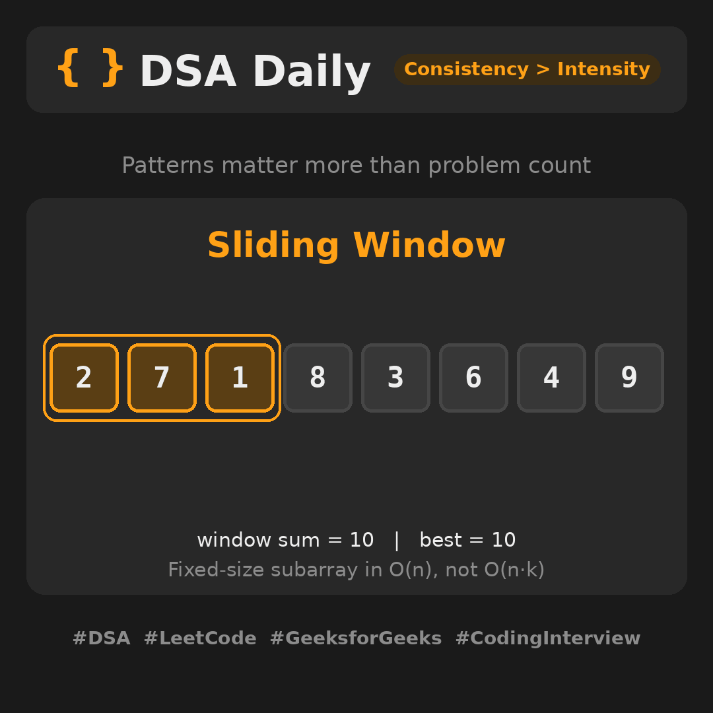

<h1 align="center">Hi 👋, I'm Gunjan Gupta</h1>
<h3 align="center">Sr Flutter Developer · 5+ years building smooth, cross-platform mobile apps</h3>

  
  
  

---

### 🚀 About me

- 💼 **Sr Flutter Developer** at **Soni Techno Pvt Ltd** (Feb 2021 – present)
- 📱 I build and ship cross-platform mobile apps end to end, from requirements to Play Store / App Store release
- 🌱 Currently upskilling in **Full Stack Development** with Bosscoder Academy
- 🧠 Practising **Data Structures & Algorithms** daily on LeetCode and GeeksforGeeks
- 📍 Jaipur, India

### 🛠️ Tech stack

**Mobile:**

**Languages:**

**Frontend:**

**Tools & concepts:**

### 💡 What I focus on

- Clean, maintainable Flutter architecture and reusable UI components
- State management and app performance (smooth frame rates, fewer rebuilds)
- Reliable REST API integration and crash-free releases

### 📂 Work

Most of my professional and personal project code lives in **private repositories**.
Happy to walk through architecture, features and demos. Just reach out on LinkedIn.

### 📊 Problem solving

  

---

⭐ Thanks for visiting! Let's connect on <a href="https://www.linkedin.com/in/gunjangupta-dev">LinkedIn</a>.

